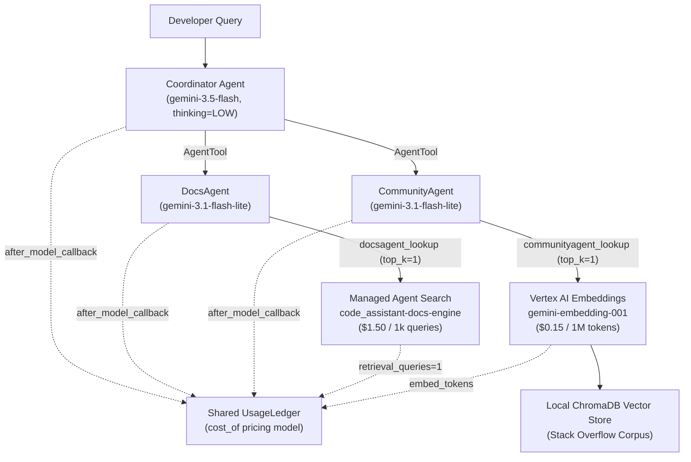

# Cost/Token Estimation, Analysis, and Optimization: Challenge Lab — Step-by-Step Runbook & Solution

This repository contains the complete solution, executed notebook ([`code_assistant_cost_optimization.ipynb`](./code_assistant_cost_optimization.ipynb)), [`code_assistant`](./code_assistant/) package, evaluation datasets ([`assets/`](./assets/)), reference grading output ([`final_metrics.json`](./final_metrics.json)), and step-by-step runbook ([`RUNBOOK.md`](./RUNBOOK.md)) for the **Cost/Token Estimation, Analysis, and Optimization: Challenge Lab**.

---

## Overview

Agentic applications drive significant model and service costs: a single user question fans out into repeated coordinator model calls, sub-agent invocations, retrieval queries, embedding calls, and reasoning ("thought") tokens.

In this challenge lab, you operate **Code Assistant Agent**, a multi-agent developer assistant built with the **Google Agent Development Kit (ADK)**:
- **`Coordinator`**: Orchestrates tool calls to sub-agents and synthesizes a single cited response.
- **`DocsAgent`**: Searches official engineering documentation and runbooks hosted on managed **Agent Search (Vertex AI Discovery Engine)**.
- **`CommunityAgent`**: Searches prior Stack Overflow discussions indexed in an in-memory **ChromaDB** vector store using **`gemini-embedding-001`**.

Using an event-level **`UsageLedger`** and an explicit pricing contract (`cost_of`), you measure the baseline cost per query and answer quality (scored by a Vertex AI Gen AI Evaluation Service autorater against reference answers), apply three cost-optimization levers (**Model Tiering**, **Context Caching**, and **Reasoning & Retrieval Token Reduction**), and solve the **Final Challenge** on 16 held-out developer queries under strict cost and quality constraints.

---

## Scorecard & Evaluation Results Summary

| Stage / Configuration | Dataset | Coordinator Model | Sub-Agent Models (`docs` / `community`) | Thinking Level | `top_k` | Cost / Query (USD) | vs. Baseline | Quality Score `[0–1]` | Verdict |
| :--- | :---: | :--- | :--- | :---: | :---: | :---: | :---: | :---: | :---: |
| **Baseline** | Dev (15) | `gemini-3.1-pro-preview` | `gemini-3.5-flash` | `HIGH` | `3` | `$0.0290` | `+0%` | `0.9333` | Baseline |
| **Lever 1a: Tiering (Flash @ HIGH)** | Dev (15) | `gemini-3.5-flash` | `gemini-3.5-flash` | `HIGH` | `3` | `$0.0185` | `-36%` | `0.9500` | High Quality |
| **Lever 1b: Tiering (Flash-Lite @ HIGH)** | Dev (15) | `gemini-3.1-flash-lite` | `gemini-3.5-flash` | `HIGH` | `3` | `$0.0127` | `-56%` | `0.8750` | Below Floor (`<0.90`) |
| **Lever 3a: Thinking `LOW` (Flash)** | Dev (15) | `gemini-3.5-flash` | `gemini-3.5-flash` | `LOW` | `3` | `$0.0124` | `-57%` | `0.9333` | Good on Dev |
| **Lever 3b: Thinking `LOW` + `top_k=2`** | Dev (15) | `gemini-3.5-flash` | `gemini-3.5-flash` | `LOW` | `2` | `$0.0140` | `-52%` | `0.9000` | Borderline |
| **Final Challenge Submission** | **Holdout (16)** | **`gemini-3.5-flash`** | **`gemini-3.1-flash-lite`** | **`LOW`** | **`1`** | **`$0.0110`** (`$0.011044`) | **`-62%`** | **`0.9062`** (`0.91`) | **PASS** (`<= $0.0135`, `>= 0.90`) |

---

## Architecture & Cost Attribution Flow



---

## Repository Structure

```text
.
├── README.md                                  # Lab overview, results summary, and quick-start guide
├── RUNBOOK.md                                 # Comprehensive step-by-step execution runbook
├── code_assistant_cost_optimization.ipynb     # Completed Jupyter notebook with all outputs & final solution
├── final_metrics.json                         # Graded final challenge output uploaded to GCS
├── notebook_config.sh                         # Workbench startup script that stages lab files from GCS
├── code_assistant/                            # Multi-agent ADK package & cost/quality plumbing
│   ├── __init__.py
│   ├── agents.py                              # ADK Coordinator, DocsAgent, CommunityAgent & callbacks
│   ├── data.py                                # JSONL dataset loader
│   ├── display.py                             # HTML metric & PASS/FAIL banner renderers
│   ├── ledger.py                              # In-memory UsageLedger for per-query cost attribution
│   ├── quality.py                             # Vertex AI EvalTask pointwise correctness rubric & runner
│   ├── retrieval.py                           # Vertex AI embedding helper & ChromaDB lookup tool
│   └── vais.py                                # Discovery Engine (Agent Search) provisioning & search tool
└── assets/                                    # Retrieval corpora and evaluation datasets
    ├── docs.jsonl                             # 20 official documentation snippets (Agent Search corpus)
    ├── stackoverflow.jsonl                    # 20 Stack Overflow Q&A posts (ChromaDB corpus)
    ├── eval_dataset.jsonl                     # 15 development queries + reference answers (Parts 1–5)
    └── eval_holdout.jsonl                     # 16 held-out queries + reference answers (Part 6 Final Challenge)
```

---

## Quick-Start Guide (Step-by-Step)

### Task 1: Open JupyterLab on Agent Platform Workbench
1. In the Google Cloud Console, navigate to **Agent Platform > Notebooks > Workbench** (or search **Agent Platform Workbench**).
2. Locate the **`generative-ai-jupyterlab`** instance and click **Open JupyterLab**.

### Task 2: Confirm (or Copy) the Lab Files
1. Verify that `code_assistant_cost_optimization.ipynb`, `code_assistant/`, and `assets/` exist in `/home/jupyter/`.
2. If missing, open a JupyterLab Terminal (**File > New > Terminal**) and copy them from the lab bucket:
   ```bash
   export PROJECT_ID=$(gcloud config get-value project)
   gcloud storage cp -r "gs://${PROJECT_ID}-bucket/*" ~/
   ```

### Task 3 & Task 4: Run Setup Cells & Provision Agent Search Resources (AT ID: 1)
1. Open `code_assistant_cost_optimization.ipynb` with the **Python 3** kernel.
2. Run the `%pip install` cell and the kernel restart cell under **Part 0**.
3. Run the remaining **Part 0** cells to:
   - Configure `PROJECT`, `LOCATION = "global"`, and `EVAL_LOCATION = "us-central1"`.
   - Load the pricing table (`PRICING`) and `cost_of(record)` function.
   - Provision the managed **Agent Search** data store (`code_assistant-docs`) and search engine (`code_assistant-docs-engine`) and index the 20 Stack Overflow documents into ChromaDB:
     ```python
     VAIS_LOCATION, DS_ID, ENGINE_ID = "global", "code_assistant-docs", "code_assistant-docs-engine"
     DOCS_SC = vais.ensure(PROJECT, VAIS_LOCATION, DS_ID, ENGINE_ID, load_jsonl("assets/docs.jsonl"))
     ```
4. Click **Check my progress** for **Task 4 (Provision the Agent Search resources)**.

### Task 5: Optimize the Code Assistant Agent's Cost and Quality (AT ID: 2)
1. Run through **Parts 1–5** of the notebook to measure the baseline (`$0.0290/query`, `0.93` quality) and evaluate the three cost optimization levers.
2. In **Part 6: Final challenge**, fill in the `[TODO: YOUR OPTIMIZATION]` block with the following optimized configuration:
   ```python
   MY_MODELS = {
       "coordinator": "gemini-3.5-flash",
       "docs":        "gemini-3.1-flash-lite",
       "community":   "gemini-3.1-flash-lite",
       "embedding":   "gemini-embedding-001",
   }
   MY_THINKING = "LOW"     # Minimizes expensive coordinator reasoning tokens
   MY_TOPK     = 1         # Returns top 1 snippet per lookup, trimming input & synthesis tokens
   MY_MAXOUT   = None      # Keeps default safety ceiling (3072 tokens)
   ```
3. Run the Final Challenge evaluation cell and the GCS upload cell.
   - **Result**: `$0.0110` per query (`<= $0.0135` budget) and `0.91` (`0.9062`) quality (`>= 0.90` quality floor) -> **PASS**.
   - Confirm `final_metrics.json` is uploaded to `gs://${PROJECT_ID}-metrics-result/results/final_metrics.json`.
4. Click **Check my progress** for **Task 5 (Optimize the Code Assistant Agent's cost and quality)**.

---

## Detailed Runbook

See **[`RUNBOOK.md`](./RUNBOOK.md)** for the complete cell-by-cell walkthrough, ledger tables, cost breakdown math, and engineering analysis of every optimization lever.
